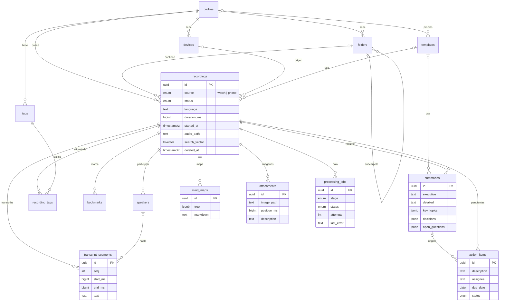

# Diagrama ER

## Notas

- Todas las tablas (salvo `templates` predefinidas) llevan `user_id` y RLS por `auth.uid()`.
- `recording_tags` y las tablas hijas validan además que la grabación padre sea del mismo usuario
  (política restrictiva `*_insert_parent_owned`).
- Audio e imágenes viven en Storage (`audio`, `attachments`), bajo la carpeta `{user_id}/`.
- La búsqueda local usa FTS4 de Room sobre `transcript_segments`; la remota, `recordings.search_vector`.
